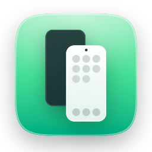

<p align="center">
  
</p>

<h1 align="center">aPhone Mirroring</h1>

<p align="center">Use your Android phone from your Mac, the way iPhone Mirroring does.</p>

- Mirror and control the phone in a window, with sound and a shared clipboard
- Connect over Wi-Fi (pair once with a QR code) or USB
- Screenshots, screen recording, file transfer, and a desktop mode on Android 14+
- Available in English, 한국어, 日本語, 简体中文, 繁體中文, Español, Français, Deutsch, Português (Brasil), Русский, and Italiano

## Install

1. Download the DMG from [Releases](https://github.com/vzts/aPhone-Mirroring/releases/latest) and drag **aPhone Mirroring** to Applications.
2. The app isn't notarized. On first launch, open **System Settings › Privacy & Security** and click **Open Anyway**.

Requires macOS 15 or later. Wireless needs Android 11 or later.

## Connect

- **Wi-Fi:** on the phone, open **Settings › Developer options › Wireless debugging**, tap **Pair device with QR code**, and scan the code in the app.
- **USB:** turn on **USB debugging** in Developer options, plug the phone in, and tap **Allow**.

Developer options appear after tapping **Build number** seven times in **Settings › About phone**.

## Build

```sh
brew install xcodegen
./scripts/bootstrap.sh   # fetches scrcpy-server and adb
xcodegen generate
open aPhoneMirroring.xcodeproj
```

## Credits

A fork of [droidMirroring-mac](https://github.com/matyle/droidMirroring-mac). Mirroring is powered by [scrcpy](https://github.com/Genymobile/scrcpy) and [adb](https://developer.android.com/tools/adb). Licensed under [Apache 2.0](LICENSE).
